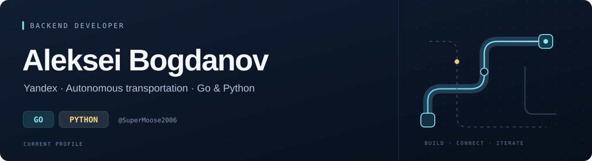

  <a href="#selected-projects"><b>Selected projects</b></a> &nbsp; / &nbsp;
  <a href="https://t.me/AlexVladimirovichB">Telegram</a> &nbsp; / &nbsp;
  <a href="https://github.com/Pozitiv4500">Earlier work ↗</a>

I’m **Aleksei Bogdanov**, a backend developer at **Yandex**, working on **autonomous transportation** in **Go**.

**Go and Python** are my strongest languages. My broader background includes **Java, C++, and C#**. This is my main GitHub account; my earlier projects live on [Pozitiv4500](https://github.com/Pozitiv4500).

## Languages & tools

| Core languages | Broader experience | Backend toolkit |
| :--- | :--- | :--- |
| **Go · Python** | Java · C++ · C# | PostgreSQL · Docker |
| Backend development | Multiple language ecosystems | FastAPI · Django · Flask |

### AI-assisted development

<table>
<tr>
<td width="50%"><b>OpenAI Codex</b> Part of my development workflow</td>
<td width="50%"><b>Claude</b> Part of my development workflow</td>
</tr>
</table>

## Selected projects

<table>
<tr>
<td width="50%" valign="top">
<h3><a href="https://github.com/SuperMoose2006/family-finance">Family Finance ↗</a></h3>

Personal and shared finance backend, with authentication, expense tracking and reports across three services.

JAVA · SPRING BOOT · POSTGRESQL

</td>
<td width="50%" valign="top">
<h3><a href="https://github.com/SuperMoose2006/peregovori-lct">Dialog ↗</a></h3>

Negotiation practice platform with a deterministic game engine and optional AI dialogue. Built for a hackathon.

PYTHON · FASTAPI · REACT

</td>
</tr>
<tr>
<td width="50%" valign="top">
<h3><a href="https://github.com/Pozitiv4500/travel_bot">Travel Bot ↗</a></h3>

Telegram bot for trip planning, shared itineraries, weather and places to visit.

PYTHON · POSTGRESQL · DOCKER COMPOSE · EARLIER WORK

</td>
<td width="50%" valign="top">
<h3><a href="https://github.com/Pozitiv4500/pulse-backend">Pulse Backend ↗</a></h3>

API for an investor social network: profiles, posts, friends and reactions. A programming challenge project.

PYTHON · FLASK · POSTGRESQL · EARLIER WORK

</td>
</tr>
</table>

---

  <b>Let’s connect</b> &nbsp; · &nbsp;
  <a href="https://t.me/AlexVladimirovichB">Telegram ↗</a>

